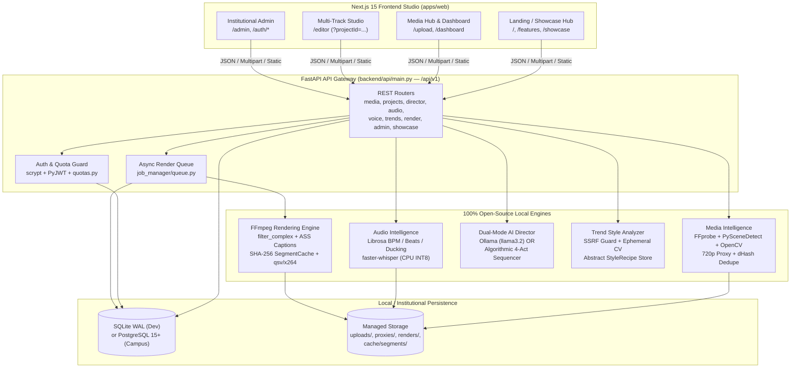
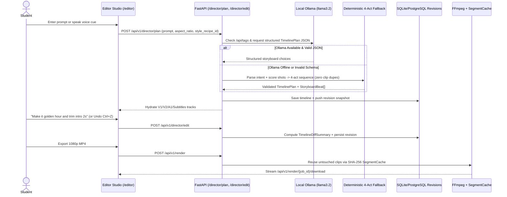

# CINEFLOW AI — System Architecture & Technical Blueprint

> **Architecture Style:** Local-First Monorepo (`apps/web` Next.js 15 + `backend/` Python 3.12 FastAPI)  
> **Core Guarantee:** Zero mandatory paid cloud APIs, strictly parameterized subprocesses (`shell=False`), and deterministic offline fallback across every AI stage.

---

## 1. End-to-End Platform Architecture

---

## 2. Dual-Mode AI Director & Conversational Edit Flow

---

## 3. Security, Subprocess Isolation & Campus RBAC Architecture

- **Zero Shell Injection:** Every binary invocation (`ffmpeg`, `ffprobe`) flows through [`ffmpeg_runner.py`](file:///c:/Users/mithu/ai%20video%20editing/backend/video_engine/ffmpeg_runner.py) using argument arrays with `shell=False` and strict path validation.
- **Upload Defense-in-Depth:** [`validator.py`](file:///c:/Users/mithu/ai%20video%20editing/backend/media_analysis/validator.py) enforces path sanitization (`../` stripped), extension allow-lists, and binary magic-byte verification (rejecting renamed payloads).
- **SSRF & Copyright Guard:** [`safety.py`](file:///c:/Users/mithu/ai%20video%20editing/backend/trend_intelligence/safety.py) rejects non-HTTP(S) schemes, credentials in URLs, loopback/private/link-local hosts (`127.0.0.1`, `169.254.169.254`, RFC 1918 subnets), and zero raw copyrighted media is retained after ephemeral feature extraction.
- **Campus Authentication & Quotas:** [`security.py`](file:///c:/Users/mithu/ai%20video%20editing/backend/authentication/security.py) hashes passwords with salted `hashlib.scrypt` and signs HS256 JWTs (`PyJWT`), guarding `/api/v1/auth/*` and `/api/v1/admin/*`, while [`quotas.py`](file:///c:/Users/mithu/ai%20video%20editing/backend/authentication/quotas.py) rejects quota-exceeding uploads with HTTP `413`.

